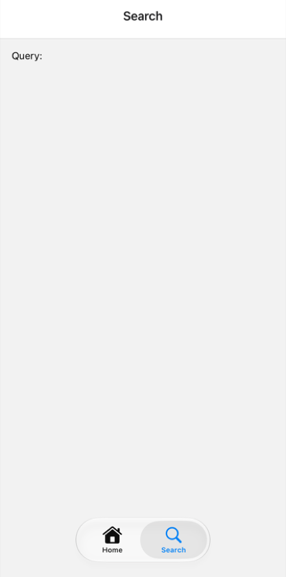
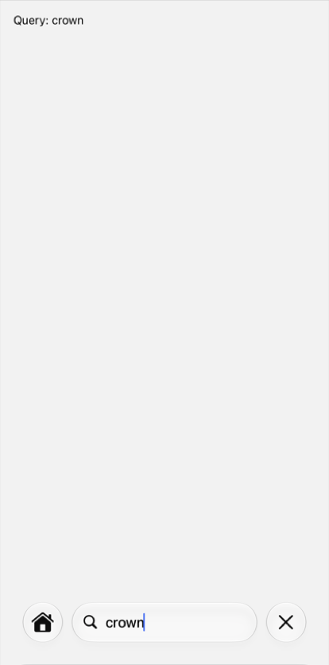

# expo-router: `role="search"` is not a separate search tab on iOS 27

Minimal repro for an Expo Router issue: `NativeTabs.Trigger role="search"` is forwarded to
react-native-screens as `ios.systemItem` only, never as `ios.role`. On iOS 27 this draws the search
tab inside the shared tab bar pill. The `UISearchTab` support that ships in `react-native-screens@4.29.0`
(the version SDK 58 installs) is never used.

`create-expo-app` (`blank-typescript@sdk-58`) + `expo-router`, installed with `npx expo install`.
Two tabs: Home, and Search with a native search bar (`headerSearchBarOptions`).

## Run

```sh
npm ci
npx expo run:ios                              # current behavior
EXPO_PUBLIC_WORKAROUND=1 npx expo run:ios     # forwards ios.role + automaticallyActivatesSearch
```

Checked on an iPhone 18 Pro simulator, iOS 27.0, Xcode 27.0.

## Result

| Default `role="search"` | Default, Search tab | Workaround | Workaround, Search tab |
| --- | --- | --- | --- |
|  |  |  |  |

The workaround in `app/_layout.tsx`:

```tsx
<NativeTabs.Trigger
  name="search"
  role="search"
  unstable_nativeProps={{ ios: { role: 'search', automaticallyActivatesSearch: true } }}
>
```
